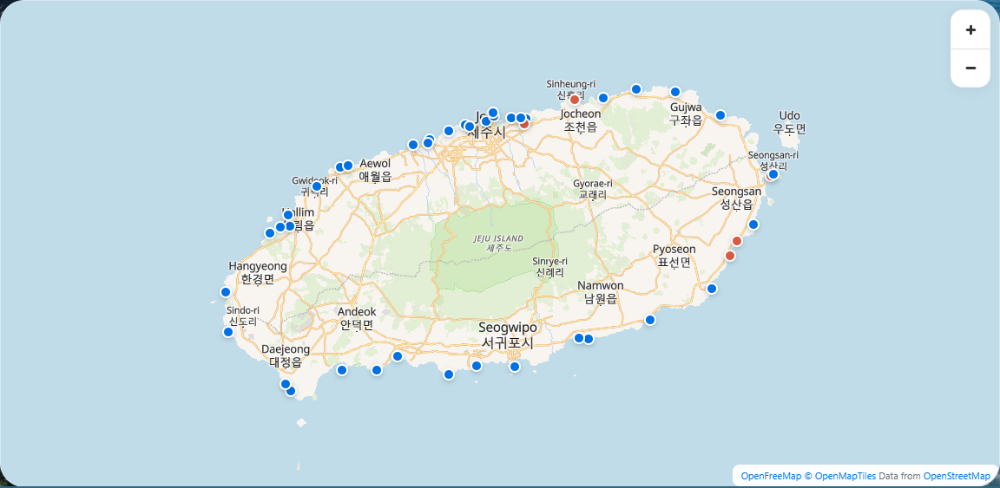
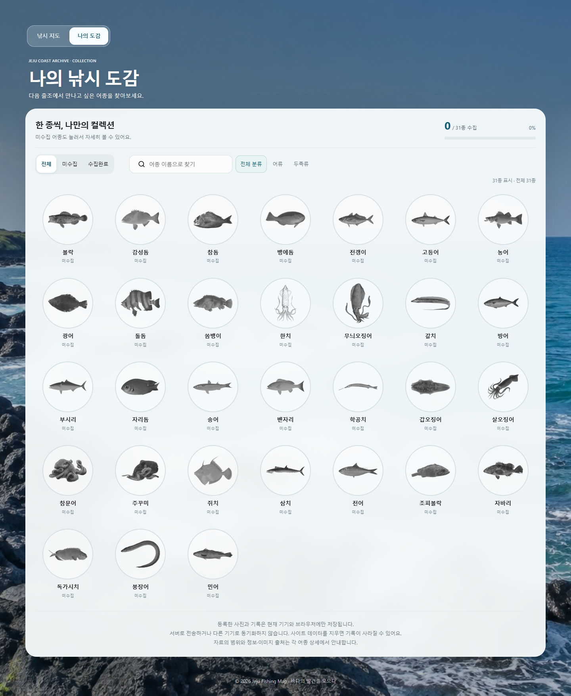
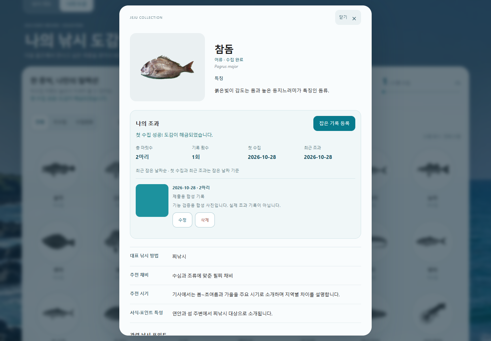

# Jeju Fishing Map & Collection

제주도 낚시 포인트를 찾아보고,
직접 잡은 어종을 기록해 나만의 낚시 도감을 만드는 웹앱입니다.

[웹사이트 바로가기](https://jeju-fishing-map.onrender.com)

[PRD](./PRD.md) · [TODO](./TODO.md) · [Agent Skills](./skills/) · [최종 테스트](./docs/FINAL_TEST_REPORT.md)

---

## 프로젝트 소개

처음에는 제주도의 낚시 포인트를 한눈에 볼 수 있는 지도를 만드는 것으로 시작했습니다.
만들면서 검색과 어종 필터, 날씨와 물때 조회를 추가했고, 이후에는 직접 잡은 어종을 남길 수 있는 도감을 만들었습니다.
도감에서 어종의 낚시 방법과 채비를 살펴본 뒤 관련 포인트를 지도에서 찾아볼 수 있습니다.
사진과 마릿수를 등록하면 회색이던 이미지가 컬러로 바뀌고, 기록 횟수와 총 마릿수가 쌓입니다.

## 프로젝트 화면

### 제주 낚시 지도

포인트를 선택하면 어종, 개인 메모, 주변 화장실과 날씨 정보를 볼 수 있습니다.



[기존 메인 화면 보기](./assets/screenshots/main.png)

### 나의 낚시 도감

31종을 살펴보고 이름이나 분류, 수집 상태로 찾아볼 수 있습니다.



### 어종 상세 및 기록

어종의 특징과 낚시 방법을 읽고, 잡은 기록을 등록하거나 수정할 수 있습니다.
아래는 합성 사진으로 첫 기록과 컬러 해금을 확인한 테스트 화면입니다.



## 주요 기능

- 제주 낚시 포인트 지도와 마커
- 포인트 검색과 어종·낚시 방법·포인트 유형 필터
- 즐겨찾기와 현재 위치 기준 가까운 포인트
- 주변 화장실, 날씨, 파고·수온, 공식 물때 오늘/내일 조회
- 고유 이미지와 상세 정보가 있는 31종 낚시 도감
- 사진·날짜·마릿수·장소·메모 등록과 기록 수정·삭제
- 첫 기록 컬러 해금과 누적 마릿수·기록 횟수·완성률 표시
- 도감 상세에서 관련 지도 포인트로 이동

## 사용 흐름

도감에서 어종 확인 → 낚시 방법과 채비 확인 → 지도에서 관련 포인트 찾기 → 실제 낚시 → 사진과 마릿수 기록 → 도감 해금

## PRD · TODO · Agent Skills

### PRD

무엇을 만들지와 어디까지 구현할지를 정리했습니다. 새 기능을 추가할 때 범위를 확인하는 기준으로 썼습니다.

[PRD 보기](./PRD.md)

### TODO

기능을 작은 작업으로 나누고, 한 단계가 끝나면 직접 실행해 확인했습니다. 확인한 내용을 작업 단위로 정리해 Commit/Push의 기준으로 삼았습니다.

[TODO 보기](./TODO.md)

### Agent Skills

어종 자료나 저장 기능을 수정할 때 빠뜨리는 일이 없도록, 반복 작업의 순서를 프로젝트 전용 Skill로 만들었습니다.

- [fish-catalog-manager](./skills/fish-catalog-manager/SKILL.md): 어종 데이터·이미지·출처 확인
- [catch-record-manager](./skills/catch-record-manager/SKILL.md): 조과 기록·IndexedDB·잠금/해금 확인
- [map-catalog-integrator](./skills/map-catalog-integrator/SKILL.md): 도감에서 지도 포인트로 이동하는 연결 확인
- [fishing-app-tester](./skills/fishing-app-tester/SKILL.md): 기능 수정 후 회귀 테스트

[Skill 사용 기록](./docs/SKILL_USAGE.md) · [최종 테스트 결과](./docs/FINAL_TEST_REPORT.md)

## 개발 방식

PRD → TODO → Skill → 기능 구현 → 직접 테스트 → Commit / Push → 다음 작업

앱 전체를 한 번에 만들어 달라고 하기보다 TODO 하나씩 구현했습니다.
문제가 생기면 직전에 바꾼 작업부터 확인할 수 있어서 수정할 부분을 찾기 쉬웠습니다.

## 문서를 사용하면서 달라진 점

| 구분 | 처음 생각했던 방식 | 실제로 사용한 방식 |
| --- | --- | --- |
| 기능 구현 | 생각나는 기능을 바로 추가 | PRD와 TODO 순서대로 진행 |
| AI 요청 | 한 번에 여러 기능 요청 | 기능 하나씩 요청 |
| 오류 수정 | 어디서 문제가 생겼는지 찾기 어려움 | 단계별로 확인 |
| Git | 마지막에 한꺼번에 올리기 | 작업 단위로 Commit/Push |
| 테스트 | 그때그때 확인 | Skill에 정한 순서로 반복 확인 |

특히 이미 만든 기능을 다시 수정할 때 문서가 도움이 됐습니다. 바꿀 내용과 유지할 내용을 나눠서 요청할 수 있었습니다.

## 사용 기술

- HTML / CSS / JavaScript
- Node.js / Express
- MapLibre GL JS / OpenFreeMap
- IndexedDB / LocalStorage
- Open-Meteo Forecast / Marine API
- 국립해양조사원 조석예보 API
- Git / GitHub / Render / Codex

## 로컬에서 실행

Node.js 22 이상과 pnpm이 필요합니다. 저장소를 내려받은 폴더에서 실행합니다.

```bash
pnpm install
pnpm start
```

공식 물때를 사용하려면 `.env.example`을 `.env`로 복사하고, 아래 예시 값을 본인의 인증키로 바꿉니다.

```env
DATA_GO_KR_SERVICE_KEY=YOUR_SERVICE_KEY_HERE
```

로컬 주소는 `http://127.0.0.1:8080`입니다. `PORT` 환경변수가 있으면 해당 포트를 사용합니다.
실제 인증키는 Git에 올리지 않습니다. 키가 없으면 물때 영역에서 설정을 안내하고 나머지 기능은 사용할 수 있습니다.

## Vibe Coding

원하는 기능을 자연어로 설명하고, Codex가 만든 코드를 직접 실행하고 수정하는 방식으로 개발했습니다.
화면이 생각과 다르게 나오면 스크린샷을 보면서 바꿀 부분을 다시 요청했습니다.

### 좋았던 점

- 익숙하지 않은 지도·API·IndexedDB도 직접 붙여보며 배울 수 있었습니다.
- 화면을 보고 여백이나 배치를 바꾸고 싶을 때 수정 요청을 전달하기 편했습니다.
- 오류 메시지를 바탕으로 원인을 좁히고 확인할 순서를 정하는 데 도움을 받았습니다.

### 아쉬웠던 점

- 좌표나 이미지가 그럴듯해 보여도 맞는 자료인지 직접 확인해야 했습니다.
- 한 기능을 고친 뒤 다른 기능이 깨지지 않았는지 다시 실행해봐야 했습니다.
- 요구사항이 모호하면 의도와 다른 결과가 나와, 금지할 변경까지 구체적으로 적어야 했습니다.

## 개발하면서 어려웠던 점

- 장소 이름만으로 정확한 좌표를 정하기 어려웠습니다. 주소와 공개 자료를 대조하고, 확인하지 못한 곳은 지도에서 제외했습니다.
- 어종 이미지에 사각 배경이 남거나 형태가 잘 보이지 않아, 종별 원본과 여백을 다시 정리했습니다.
- IndexedDB 기능을 붙인 뒤 도감 전체가 뜨지 않는 문제가 있었습니다. 오래된 서버의 새 JS 파일 404를 확인하고, 기록을 못 읽어도 기본 도감은 보이도록 수정했습니다.
- 공식 물때 인증키를 브라우저에 노출하지 않으면서 조회해야 했습니다. Node 프록시를 두고, Render에서는 서버가 `0.0.0.0`에 연결되도록 맞췄습니다.
- Popup에 정보가 많아져 도감 이동 링크는 넣지 않았습니다. 도감에서 지도 포인트를 찾는 흐름만 남겼습니다.

## 앞으로 개선할 점

- 계정으로 여러 기기의 도감 기록 동기화
- 포인트별 실제 조과 기록 통계
- PWA 형태의 휴대폰 설치 지원
- 기상특보와 현장 출입 통제 정보 연결

이번 과제에서는 지도 탐색과 개인 조과 기록까지 범위를 정하고, 나머지는 이후 개선 과제로 남겼습니다.

## 마무리

단순한 제주 낚시 지도로 시작했지만, 출조 전 정보를 찾고 다녀온 뒤 기록까지 남길 수 있는 앱으로 확장했습니다.
AI의 도움으로 낯선 기능도 시도할 수 있었지만, 화면과 데이터를 직접 확인하는 과정은 계속 필요했습니다.
PRD, TODO, Skill, Git을 함께 쓰면서 작은 작업을 끝내고 다음 단계로 넘어가는 개발 방식을 경험했습니다.

## 참고 및 주의사항

- 날씨·해상·물때는 참고용입니다. 실제 출조 전에는 기상특보와 현장 상황을 확인해야 합니다.
- 개인 메모의 안전 관련 표현은 작성 당시의 경험이며 현재 상태를 보장하지 않습니다.
- 조과 사진과 기록은 현재 브라우저의 IndexedDB에 저장됩니다. 다른 기기와 자동 동기화되지 않으며 사이트 데이터를 지우면 사라질 수 있습니다.

지도는 [MapLibre](https://maplibre.org/)와 [OpenFreeMap](https://openfreemap.org/), 날씨·해상은 [Open-Meteo](https://open-meteo.com/)와 [Marine API](https://open-meteo.com/en/docs/marine-weather-api), 물때는 [국립해양조사원 조석예보](https://www.data.go.kr/data/15156018/openapi.do)를 사용했습니다.
화장실은 [제주시 공중화장실 자료](https://www.data.go.kr/data/15110521/fileData.do)와 성산·남원 주변 보조 자료를 정리했습니다. 자세한 근거는 [구현·데이터 기록](./docs/TECHNICAL_NOTES.md)에 남겼습니다.

[어종 이미지 출처](./docs/SPECIES_ASSETS.md) · [어종 정보 출처](./docs/SPECIES_INFO_SOURCES.md)
