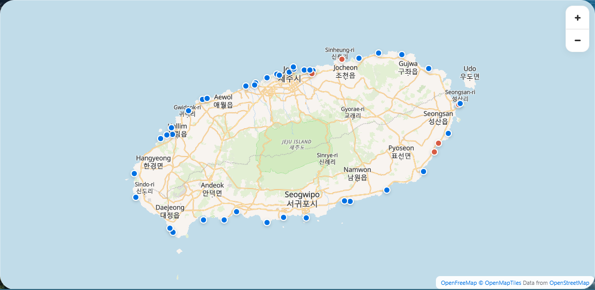
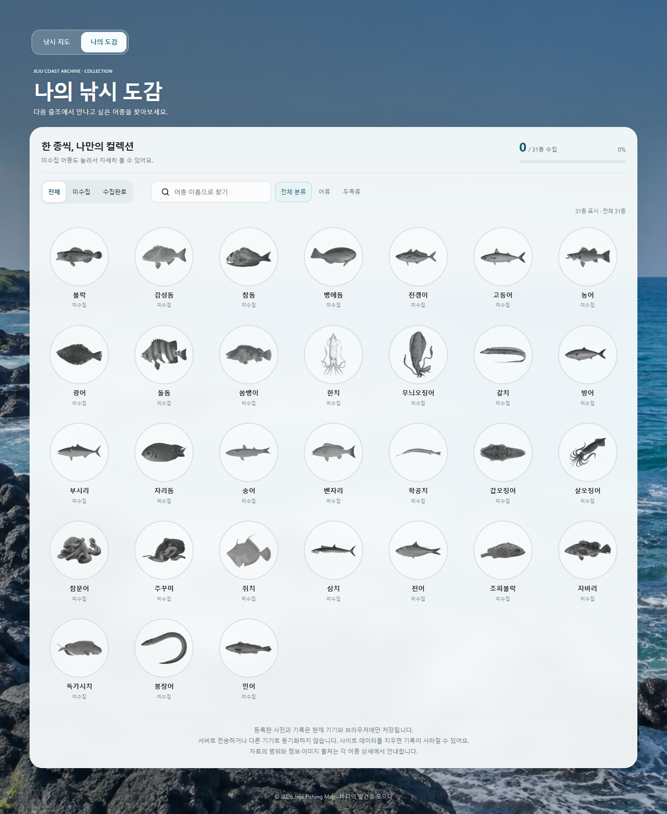
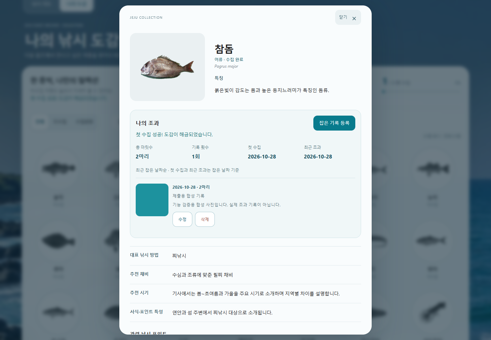

# Jeju Fishing Map & Collection

제주 낚시 포인트를 찾아보고, 직접 잡은 어종을 기록해 나만의 낚시 도감을 채우는 웹앱입니다.

[웹사이트 바로가기](https://jeju-fishing-map.onrender.com) ·
[GitHub 저장소](https://github.com/gwichaneum/jeju-fishing-map)

[PRD](./PRD.md) ·
[TODO](./TODO.md) ·
[Skill 사용 기록](./docs/SKILL_USAGE.md) ·
[최종 테스트](./docs/FINAL_TEST_REPORT.md)

---

## 1. 제작한 것

처음에는 제주도의 낚시 포인트를 한눈에 볼 수 있는 지도 앱을 만들려고 했습니다. 개발하면서 검색과 필터, 즐겨찾기, 현재 위치, 주변 화장실, 날씨와 공식 물때 기능을 하나씩 추가했습니다.

지도만으로 끝내기에는 아쉬워서 실제로 잡은 어종을 기록하는 낚시 도감도 만들었습니다. 미수집 어종은 회색으로 표시되고, 첫 조과를 등록하면 같은 이미지가 컬러로 바뀝니다.

현재는 사진·날짜·마릿수·장소·메모를 저장할 수 있고, 기록을 모아 조과 통계와 업적도 확인할 수 있습니다.

### 주요 기능

- 제주 낚시 포인트 지도와 마커
- 어종·낚시 방법·포인트 유형 검색 및 필터
- 즐겨찾기와 현재 위치 주변 포인트
- 주변 화장실, 날씨, 파고, 수온, 공식 물때
- 31종의 낚시 도감과 어종별 낚시 정보
- 사진·날짜·마릿수·장소·메모 조과 기록
- 첫 조과 등록 시 회색 이미지에서 컬러 이미지로 해금
- 어종별·월별·장소별 조과 통계
- 수집과 조과 기록을 기준으로 계산되는 24개 업적
- 도감에서 관련 제주 낚시 포인트 확인

### 사용 흐름

도감에서 어종 확인  
→ 낚시 방법과 채비 확인  
→ 지도에서 관련 포인트 찾기  
→ 실제 낚시  
→ 사진과 마릿수 기록  
→ 도감 해금  
→ 통계와 업적 확인

---

## 2. 프로젝트 화면

### 제주 낚시 지도



마커를 선택하면 포인트의 어종, 개인 메모, 주변 시설, 날씨와 물때 정보를 확인할 수 있습니다.

### 나의 낚시 도감



어종별 이미지와 특징, 낚시 방법, 추천 채비를 볼 수 있습니다. 아직 잡지 않은 어종도 기본 정보는 확인할 수 있습니다.

### 어종 상세와 조과 기록



사진과 마릿수를 등록하면 도감 이미지가 컬러로 해금되고 기록이 누적됩니다.

---

## 3. PRD와 TODO

### PRD

코딩을 시작하기 전에 어떤 앱을 만들지, 어떤 기능을 넣을지, 이번 과제에서 제외할 기능은 무엇인지 먼저 정했습니다.

처음 정한 주요 범위는 다음과 같습니다.

- 제주 낚시 포인트 지도
- 어종별 특징·낚시 방법·추천 채비
- 사진과 마릿수를 저장하는 조과 기록
- 첫 기록에 따른 도감 잠금과 해금
- 브라우저에 기록과 사진 저장
- PC와 모바일에서 사용할 수 있는 웹앱

[PRD 전체 보기](./PRD.md)

### TODO

전체 앱을 한 번에 만들지 않고 기능을 작은 작업 단위로 나누기 위해 사용했습니다.

지도 → 검색·필터 → 날씨·물때 → 도감 → 조과 기록 → 통계 → 업적 순서로 개발했고, 작업이 끝날 때마다 직접 실행해 본 뒤 Commit과 Push를 했습니다.

[TODO 전체 보기](./TODO.md)

---

## 4. TODO 변경 내역

처음 TODO에는 기본 화면, 제주도 지도, 포인트 추가, 검색, 어종 필터 정도만 있었습니다. 직접 만들고 사용해보면서 추가한 기능도 있었고, 넣었다가 다시 뺀 기능도 있었습니다.

| 구분 | 처음 계획 | 개발하면서 바뀐 내용 | 변경 이유 |
|---|---|---|---|
| 지도 | Leaflet과 OpenStreetMap 사용 | MapLibre와 OpenFreeMap으로 변경 | OpenStreetMap 타일에서 403 오류가 발생했습니다. |
| 화면 디자인 | 카드 중심의 기본 화면 | 제주 바다 전체 배경과 지도 중심 화면 | 처음 화면이 지도 앱보다 소개 페이지처럼 보였습니다. |
| 낚시 포인트 | 약 10개의 샘플 포인트 | 개인적으로 정리한 포인트와 공개 자료를 추가 | 실제로 사용할 수 있는 지도에 가깝게 만들고 싶었습니다. |
| 편의·환경 정보 | 처음 계획에는 없음 | 화장실, 날씨, 파고, 수온, 공식 물때 추가 | 출조 전에 같이 확인할 정보가 필요했습니다. |
| 낚시 도감 | 지도 앱만 제작 | 도감과 조과 기록 기능 추가 | 장소뿐 아니라 실제 낚시 결과도 남기고 싶었습니다. |
| 도감 어종 수 | 처음에는 10종 정도 | 한치·무늬오징어·갈치 등을 추가해 31종으로 확대 | 제주에서 자주 낚는 대상어를 더 넣었습니다. |
| 어종 이미지 | 일부 임시 이미지 사용 | 배경과 잘림을 검사해 어종별 이미지로 교체 | 회색 상태에서 여러 어종이 비슷하게 보이는 문제가 있었습니다. |
| 기록 저장 | 간단한 브라우저 저장 검토 | 사진과 기록을 IndexedDB에 저장 | LocalStorage는 사진을 저장하기에 적합하지 않았습니다. |
| 장소 입력 | 사용자가 장소명을 직접 입력 | 지도 포인트 검색과 사용자 장소 등록 방식으로 변경 | 같은 장소가 다른 이름으로 통계에 나뉘는 문제가 있었습니다. |
| 조과 통계 | 처음 계획에는 없음 | 총 조과, 어종별·월별·장소별 통계 추가 | 기록을 하나씩 열지 않고 모아서 보고 싶었습니다. |
| 업적 | 처음 계획에는 없음 | 수집, 마릿수, 어종군, 장소 관련 배지 추가 | 도감을 계속 채울 수 있는 다음 목표가 필요했습니다. |
| 업적 조건 | 첫 기록으로 여러 업적이 동시에 해금 | 중복 조건을 합치고 서로 다른 목표로 수정 | 같은 행동으로 여러 배지를 받아 의미가 겹쳤습니다. |
| 지도와 도감 연결 | 양방향 연결 계획 | 도감에서 지도 포인트로 이동하는 기능만 유지 | 지도 Popup에 정보가 너무 많아 가독성이 떨어졌습니다. |
| 추가 후보 | 클러스터링, 출조 일지, 로그인 | 이번 과제에서는 제외 | 기존 기능과 겹치거나 프로젝트 범위가 너무 커질 수 있었습니다. |

변경 과정을 확인할 수 있는 자료입니다.

- [초기 TODO](https://github.com/gwichaneum/jeju-fishing-map/blob/dba5f66/TODO.md)
- [도감 확장 당시 TODO](https://github.com/gwichaneum/jeju-fishing-map/blob/6df0a37/TODO.md)
- [TODO 변경 비교](https://github.com/gwichaneum/jeju-fishing-map/compare/6df0a37...d17c621)
- [오류와 수정 기록](./docs/SKILL_USAGE.md)

---

## 5. GitHub 작업 방식

기존 제주 낚시 지도 저장소에서 계속 작업했고, 완성 후 한 번에 올리지 않았습니다.

```text
PRD와 TODO 작성
→ 기능 하나 구현
→ 브라우저에서 확인
→ Commit / Push
→ 다음 작업 진행
```

대표적인 Commit은 다음과 같습니다.

```text
feat: create main page layout
feat: add working Jeju map with MapLibre
style: redesign page with full-screen ocean background
feat: add fishing spot markers and popups
feat: add fishing spot search and filters
feat: add weather and marine conditions
feat: add official tide forecast
feat: complete fish catalog data and species assets
feat: add IndexedDB catch records and collection unlock
feat: add catch statistics dashboard
feat: add achievement badge system
```

Commit 메시지에는 실제로 추가하거나 수정한 기능을 적었습니다.

[Public GitHub 저장소 바로가기](https://github.com/gwichaneum/jeju-fishing-map)

---

## 6. Agent Skills

처음에는 Codex에게 같은 검사 조건을 매번 다시 설명했습니다. 어종 데이터, 사진 저장, 지도 연결처럼 반복해서 확인할 작업이 늘어나면서 이번 프로젝트에 맞는 Skill 네 개를 직접 만들었습니다.

Skill은 모델을 다시 학습시키는 기능이 아니라, 관련 작업을 할 때 Codex가 읽고 따라가는 작업 절차입니다.

### 1) fish-catalog-manager

**만든 이유**

어종을 추가할 때 이름, 이미지, 출처, 지도 연결 키가 빠지는 것을 막기 위해 만들었습니다.

**SKILL.md 핵심 내용**

- 어종 데이터의 필수 항목과 중복 ID 확인
- 지도 필터와 `mapSpeciesKey` 비교
- 이미지의 형태, 배경, 출처와 라이선스 확인
- 검증 스크립트 실행 후 오류 수정

**실제 사용**

31종의 데이터와 이미지를 검사했습니다. 배경이 포함되거나 몸이 잘린 이미지를 교체했고, 한치와 무늬오징어처럼 비슷해 보일 수 있는 어종도 따로 확인했습니다.

[전체 SKILL.md 보기](./skills/fish-catalog-manager/SKILL.md)

### 2) catch-record-manager

**만든 이유**

사진 저장, 마릿수 계산, 수정과 삭제가 서로 연결되어 있어 같은 기준으로 반복해서 확인할 필요가 있었습니다.

**SKILL.md 핵심 내용**

- IndexedDB 구조와 조과 기록 필드 확인
- 날짜·마릿수·사진 입력 검사
- 기록 추가·수정·삭제
- 총 마릿수와 기록 횟수 재계산
- 첫 기록 해금과 마지막 기록 삭제 후 잠금 확인
- 새로고침 후 기록과 사진 복원 확인

**실제 사용**

2마리와 3마리를 등록했을 때 총 5마리, 기록 2회가 되는지 확인했습니다. 이후 장소 ID, 조과 통계와 업적 저장 기능을 만들 때도 사용했습니다.

[전체 SKILL.md 보기](./skills/catch-record-manager/SKILL.md)

### 3) map-catalog-integrator

**만든 이유**

도감의 어종 ID와 지도에서 사용하는 필터 이름이 달라 실제 경로와 연결 값을 확인할 절차가 필요했습니다.

**SKILL.md 핵심 내용**

- 지도와 도감의 실제 주소 확인
- `speciesId`와 `mapSpeciesKey` 비교
- 도감에서 관련 지도 포인트로 이동
- 관련 포인트가 없거나 잘못된 값이 들어온 경우 처리
- 뒤로가기와 기존 지도 기능 확인

**실제 사용**

무늬오징어와 한치 상세 화면에서 관련 지도 포인트로 이동하는 기능을 검사했습니다. 지도 Popup은 가독성을 위해 도감 링크를 넣지 않는 것으로 범위를 바꿨습니다.

[전체 SKILL.md 보기](./skills/map-catalog-integrator/SKILL.md)

### 4) fishing-app-tester

**만든 이유**

새 기능만 확인하면 이미 만든 지도나 저장 기능이 깨진 것을 놓칠 수 있어 반복 테스트 순서를 따로 정했습니다.

**SKILL.md 핵심 내용**

- 수정한 파일과 테스트 범위 확인
- 정적 검사와 자동 테스트 실행
- 브라우저에서 기록 등록·수정·삭제
- 새로고침 후 사진과 기록 확인
- 지도·도감·모바일 화면 재검사
- 확인하지 못한 항목은 통과로 기록하지 않기

**실제 사용**

새 JS 파일의 404 오류로 도감이 뜨지 않았던 문제, 검색 후 카드가 열리지 않던 문제, 통계와 업적 조건을 수정한 뒤 기존 기능까지 다시 확인했습니다.

[전체 SKILL.md 보기](./skills/fishing-app-tester/SKILL.md)

[Skill 실제 사용 기록 보기](./docs/SKILL_USAGE.md)

---

## 7. 개발 방법

```text
아이디어
→ PRD
→ TODO
→ Skill
→ 기능 구현
→ 직접 실행과 테스트
→ Commit / Push
→ 다음 TODO
```

Codex에 앱 전체를 한 번에 요청하기보다 TODO의 한 단계와 유지해야 할 기존 기능을 같이 설명했습니다.

이렇게 진행하니 오류가 발생했을 때 직전에 수정한 부분부터 확인하기가 편했고, 작업 과정도 Git 기록으로 남길 수 있었습니다.

### PRD·TODO·Skill을 사용하면서 달라진 점

| 구분 | 처음 생각한 방식 | 실제 개발 방식 |
|---|---|---|
| 기능 범위 | 생각나는 기능을 바로 추가 | PRD로 포함·제외 범위를 정함 |
| 작업 순서 | 그때그때 결정 | TODO 순서대로 진행 |
| AI 요청 | 여러 기능을 한 번에 요청 | 기능 하나씩 구체적으로 요청 |
| 오류 확인 | 문제가 생긴 위치를 찾기 어려움 | 직전 단계부터 확인 가능 |
| 테스트 | 필요할 때마다 다른 방식으로 확인 | Skill에 적은 순서로 반복 확인 |
| Git | 마지막에 한꺼번에 올릴 가능성 | 기능 단위로 Commit과 Push |

---

## 8. 느낀점

처음에는 Codex가 코드를 만들어주면 거의 끝일 거라고 생각했는데, 막상 해보니 원하는 결과가 맞는지 직접 확인하는 과정이 계속 필요했습니다.

어종 이미지는 출처가 있어도 실제 화면에 넣으면 몸이 잘리거나 배경이 남는 경우가 있어 여러 번 다시 골라야 했습니다. 좌표도 비슷한 위치를 넣기보다는, 직접 확인하지 못한 곳은 비워 두는 것이 더 낫다고 생각했습니다.

기록 기능을 추가했을 때는 새로 만든 JS 파일이 404 오류가 나면서 도감 전체가 뜨지 않은 적도 있었습니다. 그때 새 기능만 보는 것이 아니라 기존 기능도 같이 테스트해야 한다는 것을 알게 됐습니다.

TODO를 나누어 하나씩 작업하니 문제가 생겼을 때 어디부터 확인해야 할지 찾기가 편했습니다. Skill에 검사 순서를 적어 둔 것도 반복 작업에 도움이 됐고, 코드가 돌아간다고 끝내지 않고 실제 화면에서 사진과 기록이 저장되는지도 직접 확인했습니다.

Git 기록을 다시 보면서는 완성된 기능만 남기는 것보다, 중간에 어떤 기능을 추가했고 어떤 부분을 수정하거나 뺐는지도 같이 기록해 두는 것이 중요하다고 느꼈습니다.

---

## 9. 결론

처음에는 제주 낚시 포인트만 보여주는 지도를 만들려고 했지만, 기능을 하나씩 추가하면서 도감과 조과 기록, 통계, 업적까지 연결된 웹앱이 됐습니다.

Vibe Coding을 이용해 평소라면 어렵게 느꼈을 기능도 빠르게 시도할 수 있었습니다. 대신 AI가 만든 결과가 항상 원하는 형태로 나오는 것은 아니어서 직접 실행하고 수정하는 과정이 계속 필요했습니다.

PRD와 TODO로 작업 순서를 정하고, Skill로 반복 검사를 정리하고, Git에 작업 단위로 기록하면서 단계적으로 개발하는 방법을 경험했습니다.

현재는 Render에 배포해 브라우저에서 실제로 실행할 수 있는 상태까지 완성했습니다.

---

## 10. 실행 방법

### 배포 사이트

[https://jeju-fishing-map.onrender.com](https://jeju-fishing-map.onrender.com)

브라우저에서 지도와 도감을 바로 확인할 수 있습니다.

### 로컬 실행

```bash
pnpm install
pnpm start
```

`.env` 파일에는 공공데이터포털 인증키를 설정해야 합니다.

```env
DATA_GO_KR_SERVICE_KEY=YOUR_SERVICE_KEY_HERE
```

서버 실행 후 다음 주소로 접속합니다.

```text
http://localhost:8080
```

실제 인증키가 들어 있는 `.env` 파일은 GitHub에 올리지 않았습니다.

---

## 11. 사용 기술

- HTML / CSS / JavaScript
- Node.js / Express
- MapLibre GL JS / OpenFreeMap
- IndexedDB / LocalStorage
- Open-Meteo Weather API
- Open-Meteo Marine API
- 국립해양조사원 조석예보 API
- Git / GitHub
- Render
- VS Code / Codex

---

## 12. 앞으로 개선할 점

이번 과제에서는 브라우저에서 혼자 사용할 수 있는 범위와 기능 안정성을 우선했습니다.

앞으로 추가해볼 수 있는 기능은 다음과 같습니다.

- 로그인과 계정별 기록 관리
- 여러 기기 사이의 도감·조과 기록 동기화
- PWA 설치 지원
- 사진을 이용한 자동 어종 판별
- 기상특보와 현장 출입 통제 정보
- 관리자용 포인트·어종 데이터 수정 기능

---

## 13. 주의사항과 출처

- 날씨·해상·물때 정보는 참고용입니다.
- 실제 출조 전에는 기상특보와 현장 상황을 확인해야 합니다.
- 개인 메모의 안전 관련 표현은 현재 상태를 보장하지 않습니다.
- 조과 사진과 기록은 현재 브라우저의 IndexedDB에 저장됩니다.
- 다른 기기와 자동으로 동기화되지 않습니다.
- 로컬 실행 주소와 Render 사이트는 서로 다른 저장 공간을 사용합니다.

사용한 주요 자료:

- [MapLibre](https://maplibre.org/)
- [OpenFreeMap](https://openfreemap.org/)
- [Open-Meteo](https://open-meteo.com/)
- [Open-Meteo Marine API](https://open-meteo.com/en/docs/marine-weather-api)
- [국립해양조사원 조석예보](https://www.data.go.kr/data/15156018/openapi.do)

프로젝트 자료:

- [어종 이미지 출처](./docs/SPECIES_ASSETS.md)
- [어종 정보 출처](./docs/SPECIES_INFO_SOURCES.md)
- [구현·데이터 기록](./docs/TECHNICAL_NOTES.md)
- [최종 테스트 보고서](./docs/FINAL_TEST_REPORT.md)
